# Decoding Motor Intent from the Healthy Hemisphere after Stroke

**An end-to-end EEG analysis for a contralesional brain–computer interface (IpsiHand-type) for stroke rehabilitation.** It covers raw-signal processing, ERD/ERS physiology, intent decoding, electrode reduction, confound control, cross-dataset replication on 4 open datasets (154 recordings), and advanced analyses (ICA, spectral parameterisation, connectivity, cluster statistics, transfer learning, deep learning).

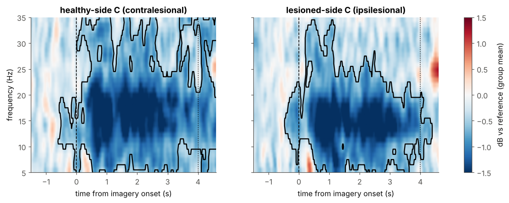
*Imagined movement of the paralysed hand: significant 10–25 Hz power decrease (ERD) over both hemispheres in 47 acute stroke patients, larger over the healthy hemisphere. Black contours: cluster-based permutation test, family-wise corrected.*

---

## Contents
- [Background](#background)
- [Datasets](#datasets)
- [Notebooks](#notebooks)
- [Processing pipeline](#processing-pipeline)
- [Key findings](#key-findings)
- [Reproduce](#reproduce)
- [Repository layout](#repository-layout)
- [Data-integrity issues found and handled](#data-integrity-issues-found-and-handled)
- [Limitations](#limitations)
- [References](#references)

## Background
After a stroke in one hemisphere, the hand on the opposite side is paralysed. Contralesional BCIs such as **IpsiHand (Kandu)** record EEG over the **healthy** hemisphere, on the same side as the paralysed hand. When the patient tries to move, μ/β power there drops (event-related desynchronisation, ERD). The device detects that drop and drives a hand orthosis, pairing intent with movement to promote plasticity.

The published design (Bundy et al., *Stroke* 2017) uses a handful of electrodes, a common-average reference, **one control electrode** and **one patient-specific frequency**. This project rebuilds that pipeline from raw data and tests how it could be improved: fewer electrodes, frequency choice, latency, calibration length, transfer across patients, and robustness to artefacts.

## Datasets
| Dataset | Population | Task | Channels | Links |
|---|---|---|---|---|
| **Liu et al. 2024**: acute stroke MI | 50 acute stroke patients (47 usable) | imagined hand grip, video-guided | 29 EEG + 2 EOG, 500 Hz | [figshare](https://doi.org/10.6084/m9.figshare.21679035) · [NEMAR nm000158](https://nemar.org/dataexplorer/detail?dataset_id=nm000158) · [paper](https://doi.org/10.1038/s41597-023-02787-8) |
| **BNCI 2019-001**: Ofner et al. 2019 | 9 people with cervical spinal cord injury | **attempted** hand open / palmar / lateral grasp | 61 EEG + 3 EOG, 256 Hz | [Zenodo](https://zenodo.org/records/2222268) · [BNCI Horizon](https://bnci-horizon-2020.eu/database/data-sets) · [paper](https://doi.org/10.1038/s41598-019-43594-9) |
| **PhysioNet EEGMMIDB**: Schalk et al. 2004 | 49 healthy adults (subjects 1–50) | executed and imagined fist open/close | 64 EEG, 160 Hz | [PhysioNet](https://physionet.org/content/eegmmidb/1.0.0/) · [paper](https://doi.org/10.1109/TBME.2004.827072) |
| **BCI Competition IV-2a** (BNCI 2014-001) | 9 healthy adults | imagined left / right hand | 22 EEG + 3 EOG, 250 Hz | [BCI Competition IV](https://www.bbci.de/competition/iv/) · [MOABB loader](https://moabb.neurotechx.com/docs/generated/moabb.datasets.BNCI2014_001.html) |

Each external dataset isolates one aspect the stroke data lack. **Attempted** movement of a paralysed hand (SCI) is closest to IpsiHand therapy. Executed vs imagined movement in the same people, plus a normative laterality reference, comes from PhysioNet. IV-2a is the standard benchmark that validates the pipeline. Raw data are not stored here; `scripts/download_data.py` fetches all four (~6 GB).

## Notebooks
| Notebook | Content | Rendered |
|---|---|---|
| [`01_pipeline_single_patient.ipynb`](Notebook 01, single patient) | Every processing step on one stroke patient, with the rationale for each parameter | [HTML](notebooks/html/01_pipeline_single_patient.html) |
| [`02_group_analysis.ipynb`](notebooks/02_group_analysis.ipynb) | Eight research questions on 47 stroke patients | [HTML](notebooks/html/02_group_analysis.html) |
| [`03_cross_dataset_replication.ipynb`](notebooks/03_cross_dataset_replication.ipynb) | Identical pipeline on SCI, healthy and benchmark data | [HTML](notebooks/html/03_cross_dataset_replication.html) |
| [`04_advanced_eeg_analyses.ipynb`](notebooks/04_advanced_eeg_analyses.ipynb) | ICA, FOOOF, BSI/DAR, wPLI, cluster permutation, MRCP, reliability, learning curves, transfer learning, EEGNet | [HTML](notebooks/html/04_advanced_eeg_analyses.html) |

The `.ipynb` files render directly on GitHub with all outputs. The HTML copies are for offline viewing (download, then open in a browser).

## Processing pipeline
```
raw EEG (µV, DC-coupled)
 → DC removal (per segment)
 → 1 Hz high-pass  ·  50/60 Hz notch + harmonics  ·  40 Hz low-pass   (FIR, zero-phase offline / causal IIR online)
 → channel QC: robust amplitude z, neighbour correlation, 1/f aperiodic slope (dead-recording detection)
 → downsample to 250 Hz (anti-aliased, polyphase)
 → EOG regression  ·  adaptive peak-to-peak trial rejection on decoder channels
 → re-reference (CAR / Laplacian / bipolar)  →  epochs around movement onset
 → ERD/ERS (Pfurtscheller), Morlet time-frequency, r² maps
 → features: 1-Hz log-power (Welch / AR-Burg), band power, covariance matrices
 → decoders: IpsiHand-like single-bin LDA · shrinkage LDA · CSP · Riemannian tangent space · EEGNet
 → leakage-safe grouped cross-validation, permutation tests, non-parametric group statistics
 → causal pseudo-online controller (500 ms AR window every 125 ms)
```

| Filtering, step by step | Aliasing when downsampling without a low-pass |
|---|---|
| 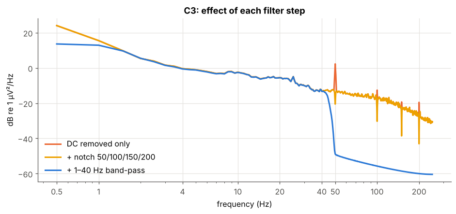 | 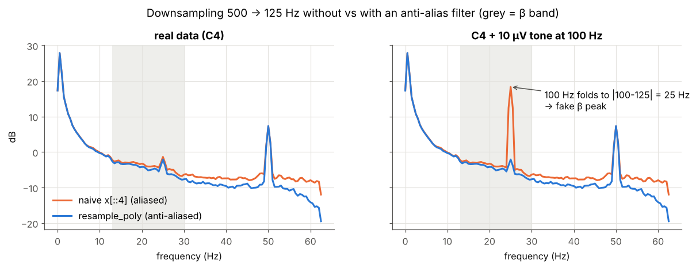 |

| Causal (device) vs zero-phase (offline) filtering | Quality control: real EEG vs a dead recording |
|---|---|
| 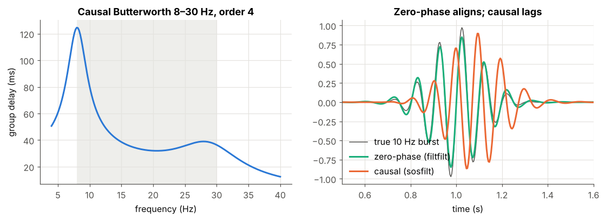 | 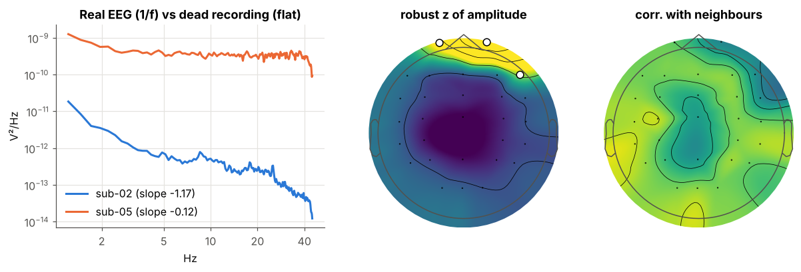 |

## Key findings
| Finding | Evidence |
|---|---|
| Automatic QC is required | 3 of 50 stroke recordings are white noise (aperiodic slope ≈ 0) |
| Healthy-hemisphere ERD is present after stroke | 91% of patients; significant 10–25 Hz cluster, larger on the healthy side |
| Stroke abolishes normal lateralisation | contralateral dominance in 78–82% of healthy subjects vs 49% of stroke patients |
| The ipsilateral hemisphere carries intent information | 6-electrode ipsilateral montage: AUC 0.70–0.81 in every dataset; after stroke equal to the lesioned side |
| Attempted / executed movement beats imagery | 0.78 vs 0.70 in the same 49 people; SCI attempt 0.81 |
| One control electrode: the reference does not matter | no significant difference in any of 5 datasets (bipolar ≈ Laplacian ≈ CAR) |
| Use the electrodes as features | multivariate 6-electrode decoding beats the best single electrode in 4 of 5 datasets |
| Broad band, ~1 s AR windows, 125 Hz | fixed 8–30 Hz beats per-patient bins with ~20 trials; AR beats Welch; no loss at 125 Hz |
| Eye confounds must be controlled | EOG / forehead channels alone reach AUC 0.67–0.74 in every dataset |
| Calibration can be short or skipped | > 0.9 after ~40–60 attempts per class; calibration-free models reach ~90% of calibrated |
| Deep learning is not yet worth it at this scale | EEGNet ≤ Riemannian tangent space |

### Physiology: where the ERD is
| Mirrored group topography (left = healthy hemisphere) | Laterality: healthy datasets vs stroke |
|---|---|
| 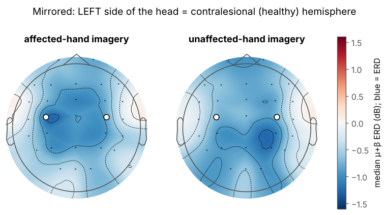 | 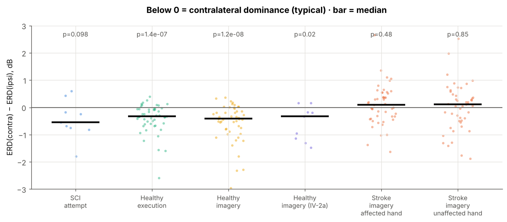 |

### Decoding: what matters
| Attempted / executed vs imagined movement | Electrodes and reference across datasets |
|---|---|
| 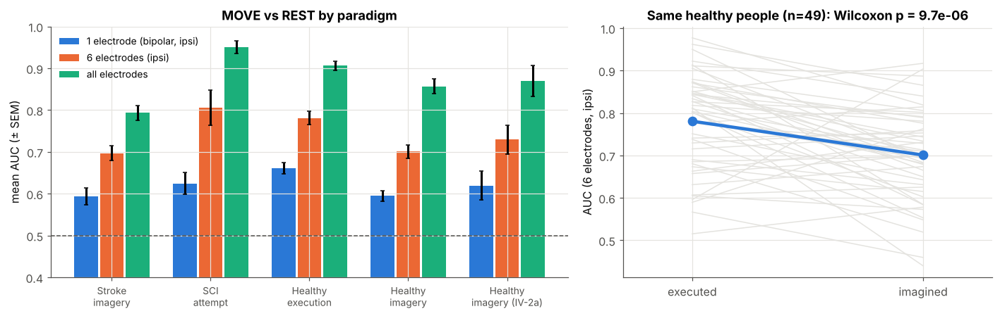 | 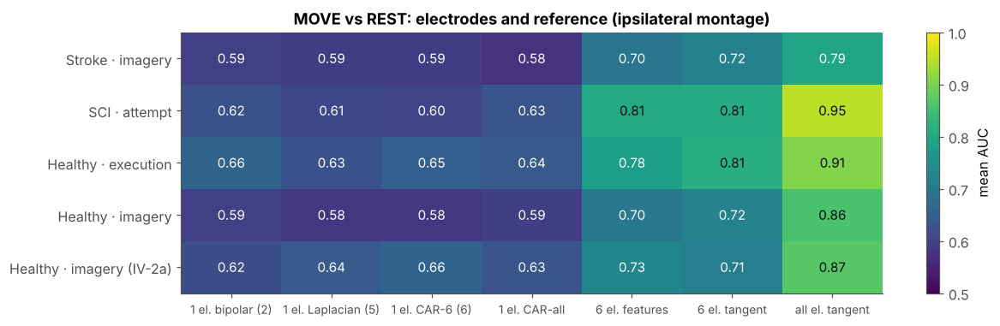 |

### Is it motor cortex or the eyes?
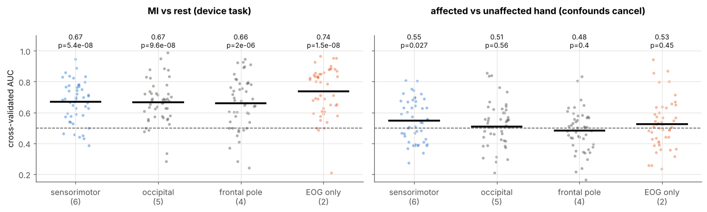
*Left: for MOVE vs REST in the stroke paradigm, the two EOG channels alone outperform the sensorimotor channels. Right: when the visual display is matched (affected vs unaffected hand), only the sensorimotor channels carry information.*

### Calibration
| Learning curves | Calibration-free decoding (Riemannian re-centring) |
|---|---|
| 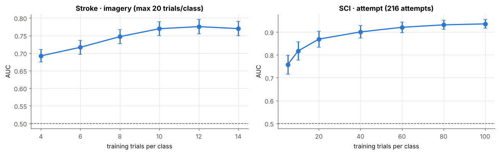 | 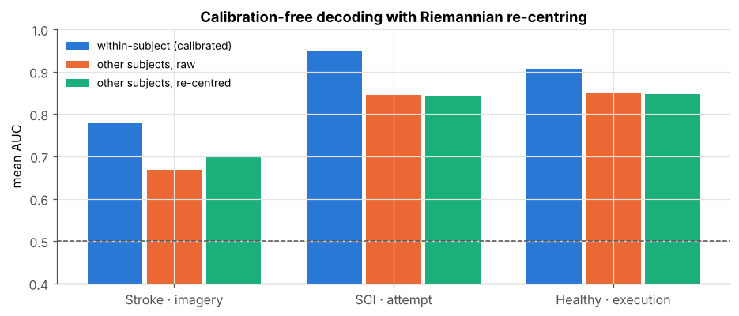 |

All 43 figures are in [`figures/`](figures/).

## Reproduce
```bash
git clone https://github.com/Tiakat/stroke-bci-eeg-pipeline.git
cd stroke-bci-eeg-pipeline
pip install -r requirements.txt
python scripts/download_data.py           # ~6 GB: all four datasets
python scripts/run_group_analysis.py      # stroke group analysis        (~25 min, 2 CPUs)
python scripts/run_confound_check.py      # EOG vs sensorimotor control  (~5 min)
python scripts/run_cross_dataset.py       # 154 recordings, 4 datasets   (~60 min)
python scripts/run_advanced.py            # advanced analyses            (~60 min)
jupyter lab notebooks/
```
`results/` already contains every computed output, so notebooks 02 and 03 run without downloading any data. Notebooks 01 and 04 recompute some steps live from the raw data.

## Repository layout
```
src/kandu_eeg/
  config.py         every constant and its justification
  io.py             stroke data loader (segment-aware, robust trigger parsing)
  datasets.py       unified loaders for the four datasets
  preprocessing.py  DC removal, FIR filtering, QC, resampling, EOG regression, epochs
  spatial.py        hemisphere mapping, CAR, Laplacian, bipolar, mirroring
  features.py       Welch and AR (Burg) spectra, band power, signed r², ERD/ERS
  decoding.py       decoders (LDA, CSP, Riemann), grouped CV, permutations, greedy channel selection
  benchmark.py      cross-dataset analysis engine
  advanced.py       FOOOF, BSI/DAR, wPLI, cluster tests, re-centring transfer, learning curves, EEGNet
  online.py         causal pseudo-online controller
  viz.py            plotting style
notebooks/          4 executed notebooks + HTML exports
scripts/            data download and analysis runners
results/            all computed outputs (CSV / NPZ)
figures/            every figure from the notebooks
```

## Data-integrity issues found and handled
- **Liu 2024:**
  - The 8-s trial blocks are not contiguous (2–30× normal step size at joins), so each block is filtered as its own segment.
  - The trigger channel contains non-integer glitches.
  - The CPz reference is stored as a flat row.
- **BNCI 2019-001:** GDF files end with NaN samples, and values are stored in µV but labelled V.
- **PhysioNet:** amplifier scale requires an adaptive rejection threshold.
- **All datasets:**
  - Event sample indices must be rescaled after resampling; this bug was caught in validation because it gave below-chance AUCs.
  - Riemannian features need scale-free mapping for covariances in V².

## Limitations
- Acute stroke imagery and SCI attempt are proxies for chronic stroke attempt.
- The 6-electrode device montage is an assumption based on the published IpsiHand description.
- Single sessions with ~20 trials per class (stroke) limit per-patient statistics: the split-half reliability of a patient's ERD is 0.26.

## References
- Bundy D.T. et al. (2017). Contralesional brain–computer interface control of a powered exoskeleton for motor recovery in chronic stroke survivors. *Stroke* 48(7).
- Liu H. et al. (2024). An EEG motor imagery dataset for brain computer interface in acute stroke patients. *Scientific Data* 11, 131.
- Ofner P. et al. (2019). Attempted arm and hand movements can be decoded from low-frequency EEG from persons with spinal cord injury. *Scientific Reports* 9, 7134.
- Schalk G. et al. (2004). BCI2000: a general-purpose brain-computer interface system. *IEEE TBME* 51(6).
- Pfurtscheller G. & Lopes da Silva F.H. (1999). Event-related EEG/MEG synchronization and desynchronization. *Clin Neurophysiol* 110.
- Donoghue T. et al. (2020). Parameterizing neural power spectra into periodic and aperiodic components. *Nature Neuroscience* 23.
- Maris E. & Oostenveld R. (2007). Nonparametric statistical testing of EEG- and MEG-data. *J Neurosci Methods* 164.
- Zanini P. et al. (2018). Transfer learning: a Riemannian geometry framework with applications to BCIs. *IEEE TBME* 65(5).
- Lawhern V.J. et al. (2018). EEGNet: a compact convolutional neural network for EEG-based BCIs. *J Neural Eng* 15.
